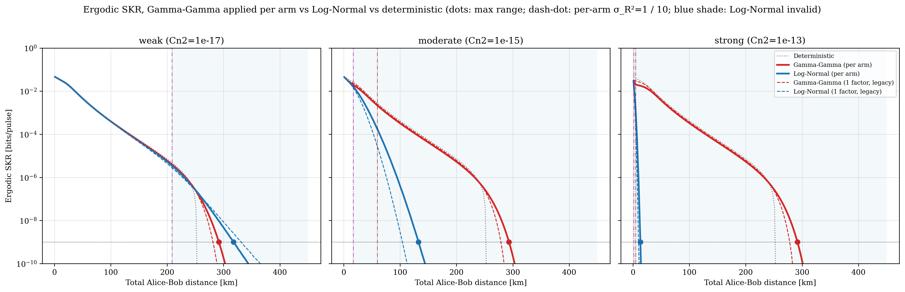
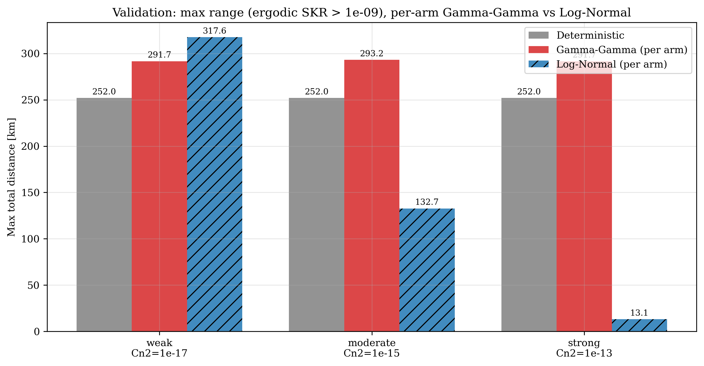
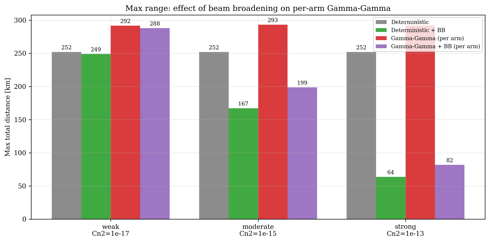

# TFQKD_MultiTurbulence

[](pyproject.toml)
[](LICENSE)
[](tests)
[](CHANGELOG.md)

Twin-field QKD over free-space optical links, with a choice of atmospheric turbulence models behind one
interface: deterministic (no turbulence), Log-Normal, Gamma-Gamma, corrected Gamma-Gamma, and versions of
these with turbulence-induced beam broadening. In a twin-field link both Alice and Bob send to Charlie, so
turbulence is applied separately to each arm (Alice to Charlie, Bob to Charlie) rather than once to the whole
distance. Each model's key rate is cross-checked against Monte Carlo.

The Curty-Azuma-Lo (2019) security proof and the original Log-Normal code are reused as they were, in
`src/legacy_baseline.py`. Everything else reaches them only through `TFQKDEngine` and the `TurbulenceChannel`
interface.

<p align="center">
  
</p>

## Main results

The table gives the longest total Alice-Bob distance at which the ergodic key rate stays above 1e-9
bits/pulse. Link parameters: 1550 nm, 5 cm beam waist, 15 cm receiver radius, 0.2 dB/km attenuation. Weak,
moderate and strong mean Cn2 = 1e-17, 1e-15 and 1e-13 m^(-2/3).

| Model | Weak | Moderate | Strong |
|---|---|---|---|
| No turbulence | 252.0 km | 252.0 km | 252.0 km |
| Gamma-Gamma, per arm | 291.7 km | 293.2 km | 291.7 km |
| Log-Normal, per arm | 317.6 km | 132.7 km | 13.1 km |
| Gamma-Gamma + beam broadening, per arm | 287.9 km | 198.6 km | 81.9 km |

A few things to keep in mind when reading it. Log-Normal is only valid while the Rytov variance of one arm is
at most 1; inside that range it tracks Gamma-Gamma to within a few percent, and past it the two separate
quickly. Plain Gamma-Gamma saturates, so its range hardly depends on Cn2. Fading even stretches the range
about 40 km past the no-turbulence cutoff, because occasional strong upward fades lift the average key rate
near the cutoff. Beam broadening is a loss on the mean power, and it is what makes the range shrink as Cn2
grows. For strong turbulence the two Gamma-Gamma rows work as an upper and a lower bound
(see [docs/BEAM_BROADENING.md](docs/BEAM_BROADENING.md), section 7).

<p align="center">
  
  
</p>

## Models

| Model | Where it applies | Notes |
|---|---|---|
| Deterministic | no turbulence | wraps the validated baseline |
| Log-Normal | weak turbulence, Rytov variance below 1 | wraps the validated baseline |
| Gamma-Gamma | moderate to strong | Andrews-Phillips alpha and beta, written from the theory |
| Corrected Gamma-Gamma | strong, finite receiver | adds aperture averaging, beam wander and pointing error |
| `gamma_gamma_bb`, `lognormal_bb`, `gamma_gamma_corrected_bb` | large Cn2, where mean power is lost | long-term beam broadening on each arm, on top of the fading model |

With `model="auto"` the factory chooses from the Rytov variance of one arm. You can always name a model
yourself. The physics is written up in [THEORY](docs/THEORY.md), [GAMMA_GAMMA](docs/GAMMA_GAMMA.md),
[CORRECTED_GAMMA_GAMMA](docs/CORRECTED_GAMMA_GAMMA.md), [TWO_LINK_FADING](docs/TWO_LINK_FADING.md) and
[BEAM_BROADENING](docs/BEAM_BROADENING.md).

## Version history

The full list is in [CHANGELOG.md](CHANGELOG.md).

| Version | What changed |
|---|---|
| 2.3.1 | Examples 01-05 re-run. New outputs in `results_v2.3.0/`, old ones archived in `old_results_v2.1.0_pre_gg_fix/`. Removed a leftover cutoff (Rytov variance above 300) from examples 04 and 05. |
| 2.3.0 | Beam-broadening models (`*_bb`), example 07, [BEAM_BROADENING.md](docs/BEAM_BROADENING.md). |
| 2.2.0 | Fixed the Gamma-Gamma alpha/beta exponent (see below). More stable Gamma-Gamma CDF, better quadrature nodes, per-arm validation against Log-Normal (example 06). |
| 2.1.0 | Independent fading on each arm (`TwoLinkChannel`) became the default. |
| 2.0.0 | First multi-model framework. |

Version 2.2.0 matters if you used earlier results. The alpha/beta formulas raised the Rytov variance to the
12/5 power, when Andrews and Phillips use the Rytov standard deviation, which is the variance to the 6/5
power. That made the scintillation index fall to almost zero in strong turbulence, so moderate and strong
Gamma-Gamma results from 2.0 and 2.1 came out too optimistic. Weak turbulence was not affected.

## Installation

```bash
git clone https://github.com/<your-username>/TFQKD_MultiTurbulence.git
cd TFQKD_MultiTurbulence
pip install -r requirements.txt
python -m pytest tests        # 50 tests, about 45 s
# optional: pip install -e .  (installs the package from pyproject.toml)
```

You need Python 3.9 or newer, NumPy, SciPy, Matplotlib, mpmath and pytest. mpmath only backs up the
large-order Bessel-K evaluation in the Gamma-Gamma PDF (see docs/GAMMA_GAMMA.md); the CDF used for
quadrature no longer relies on it.

## Quick start

```python
from src.turbulence import create_channel
from src.tfqkd_engine import TFQKDEngine
import numpy as np

engine = TFQKDEngine(pd=1e-7, thetaA=np.arcsin(np.sqrt(0.02)),
                     thetaB=-np.arcsin(np.sqrt(0.02)), Nmax=4)

# "auto" chooses the turbulence model from the link geometry
channel = create_channel('auto', eta_nominal=0.05, Cn2=3e-15,
                         wavelength=1550e-9, distance_m=6000,
                         receiver_radius=0.15, jitter_std=1e-6)
print(channel.name)            # two_link_lognormal for this geometry
print(channel.statistics())    # mean, variance, scintillation index, per arm

R = engine.ergodic_key_rate(channel, alpha=0.20, method="quadrature")
print(f"Ergodic key rate: {R:.4e} bits/pulse")

alpha_opt, R_opt = engine.optimize_fixed_alpha(channel)
print(f"Best fixed alpha: {alpha_opt:.4f}, key rate: {R_opt:.4e}")

# Gamma-Gamma on each arm plus beam broadening (v2.3)
ch_bb = create_channel('gamma_gamma_bb', eta_nominal=1e-3, Cn2=1e-15,
                       wavelength=1550e-9, distance_m=100e3,
                       w0=0.05, receiver_radius=0.15)
print(engine.ergodic_key_rate(ch_bb, alpha=0.20, method="quadrature"))
```

## Repository layout

```
TFQKD_MultiTurbulence/
├── README.md, LICENSE, CHANGELOG.md, CITATION.cff, CONTRIBUTING.md, pyproject.toml, requirements.txt
├── docs/        theory, one derivation per model, validation notes, API reference, generated *_REPORT.txt files
├── src/
│   ├── legacy_baseline.py    TF-QKD security proof, deterministic FSO channel, Log-Normal (unchanged)
│   ├── turbulence/           base interface, the channel models, two_link.py, beam_broadening.py, factory
│   ├── monte_carlo.py, quadrature.py, adaptive_alpha.py
│   └── tfqkd_engine.py, statistics.py, plotting.py, validation.py, utils.py, constants.py
├── examples/    scripts 01 to 07
├── tests/       50 tests (PDF/CDF checks, moments, Monte Carlo vs quadrature, two-link, beam broadening)
├── results_v2.3.0/                  current figures, reports and logs
├── old_results_v2.1.0_pre_gg_fix/   earlier outputs, kept for comparison only
└── figures/     scratch output of the examples (git-ignored)
```

## Examples

```bash
python3 examples/example_01_model_comparison.py                  # all models, weak to strong turbulence
python3 examples/example_02_adaptive_alpha.py                    # fixed, optimized and instantaneous-adaptive alpha
python3 examples/example_03_distance_sweep_and_validation.py     # key rate vs distance, validation report
python3 examples/example_04_max_range_and_validity.py            # max range, regime validity, AUTO selection
python3 examples/example_05_instantaneous_adaptive_all_graphs.py # adaptive-alpha graphs
python3 examples/example_06_gamma_gamma_per_arm_validation.py    # per-arm Gamma-Gamma vs Log-Normal, 10 figures
python3 examples/example_07_beam_broadening_gamma_gamma.py       # with and without beam broadening
```

Example 06 is the slow one. `QUICK=1 python3 examples/example_06_gamma_gamma_per_arm_validation.py` runs a
coarse version in a few minutes.

`results_v2.3.0/` holds the current figures, reports and logs for all seven examples, plus a short note on how
they differ from the old ones. `old_results_v2.1.0_pre_gg_fix/` was produced before the exponent fix, so don't
quote its moderate or strong Gamma-Gamma numbers. Figures are also described in docs/FIGURES.md.

## Analytical formula validation

`analytical_validation/` tests the closed-form turbulence-averaging formulas of the manuscript (log-normal, Hermite /
Euler-Stirling expansion) and of the progress report (Gamma-Gamma, cumulant expansion with aperture averaging) against
independent quadrature, Monte Carlo and a 60-digit derivative reference, and writes tables and graphs into a PDF.
Run `python3 analytical_validation/run_all.py`; see [analytical_validation/README.md](analytical_validation/README.md).

## Documentation

| File | Contents |
|---|---|
| THEORY.md | Kolmogorov spectrum, Rytov variance, Log-Normal, Gamma-Gamma, per-arm fading, beam broadening |
| GAMMA_GAMMA.md, LOGNORMAL.md, CORRECTED_GAMMA_GAMMA.md | One derivation per model |
| TWO_LINK_FADING.md | Independent fading on the Alice-Charlie and Bob-Charlie arms |
| BEAM_BROADENING.md | Long-term beam broadening, assumptions, validity limits |
| VALIDATION.md, QUADRATURE.md, MONTE_CARLO.md, PERFORMANCE.md | Numerical checks and benchmarks |
| GAMMA_GAMMA_PER_ARM_REPORT.txt, BEAM_BROADENING_REPORT.txt | Max-range reports from examples 06 and 07 |

## Validation

Details are in docs/VALIDATION.md. At ordinary operating points, independent Monte Carlo and quadrature
estimates of the ergodic key rate agree to well under 0.1 % for all three stochastic models. Right at the
outage threshold, where the rate is carried by rare upward fades, the agreement is looser (about 1 to 3 %
against 10^6 to 10^7 samples). The same document describes two bugs this check caught during development, a
truncated integration bound and an adaptive quadrature that missed a narrow density spike. Re-run it after
touching `quadrature.py` or any model's `pdf()`.

## Benchmarks

docs/PERFORMANCE.md measures Monte Carlo sample count against accuracy and runtime, and Gauss-Legendre order
against accuracy and runtime. It reports one representative sweep, not the full cross product.

## Limitations

* Figures are exported as PNG and PDF. SVG would be a one-line change in `plotting._save()`.
* There are no notebooks. Every workflow is a plain script; `jupytext` converts one if you want it.
* The inner and outer turbulence scales enter only as a first-order correction to the Rytov variance, not as
  a full von Karman integral (docs/CORRECTED_GAMMA_GAMMA.md, section 5).
* The spherical-wave Gamma-Gamma formulas use Theta = 1 instead of a general Gaussian beam treatment
  (docs/GAMMA_GAMMA.md, section 3).
* The beam-broadening formula comes from weak-to-moderate turbulence theory and does not saturate. At strong
  Cn2 it probably overstates the loss, so the strong-turbulence `*_bb` range is a conservative lower bound
  (docs/BEAM_BROADENING.md, section 7).

None of these change the results for the cases the code is meant to cover. Issues and pull requests are
welcome.

## References

- Curty, M., Azuma, K. & Lo, H.-K., "Simple security proof of twin-field
  type QKD protocol," npj Quantum Information 5, 64 (2019); arXiv:1807.07667v2.
- Andrews, L. C. & Phillips, R. L., *Laser Beam Propagation through
  Random Media*, 2nd ed., SPIE Press, 2005 (Ch. 6 for the long-term beam radius used in the
  beam-broadening model).
- Al-Habash, M. A., Andrews, L. C. & Phillips, R. L., "Mathematical model
  for the irradiance probability density function of a laser beam
  propagating through turbulent media," Opt. Eng. 40(8), 1554-1562 (2001).
- Farid, A. A. & Hranilovic, S., "Outage Capacity Optimization for
  Free-Space Optical Links with Pointing Errors," J. Lightwave Technol.
  25(7), 1702-1710 (2007).
- Goodman, J. W., *Statistical Optics*, Wiley, 1985/2015.
- Korotkova, O., *Random Light Beams: Theory and Applications*, CRC
  Press, 2013.

## Citation

If you use this code, please cite the physics papers above and the software itself
(see [CITATION.cff](CITATION.cff); GitHub also offers a "Cite this repository" button).
Contribution notes are in [CONTRIBUTING.md](CONTRIBUTING.md).

## Authors and supervision

Anand Kumar, research intern at the Centre for Applied Research in Electronics (CARE), IIT Delhi, June to December 2026.

Supervisor: Dr. Neelkanth Kundu. Co-supervisor: Dr. Ramniwas Meena.

## Acknowledgements

This work was carried out during a research internship at CARE, IIT Delhi (June to December 2026). The author thanks the supervisors for their guidance, and
acknowledges the support of the National Quantum Mission (NQM) and the Samngya Foundation.

## License

MIT, see LICENSE. Copyright (c) 2026 Anand Kumar.
